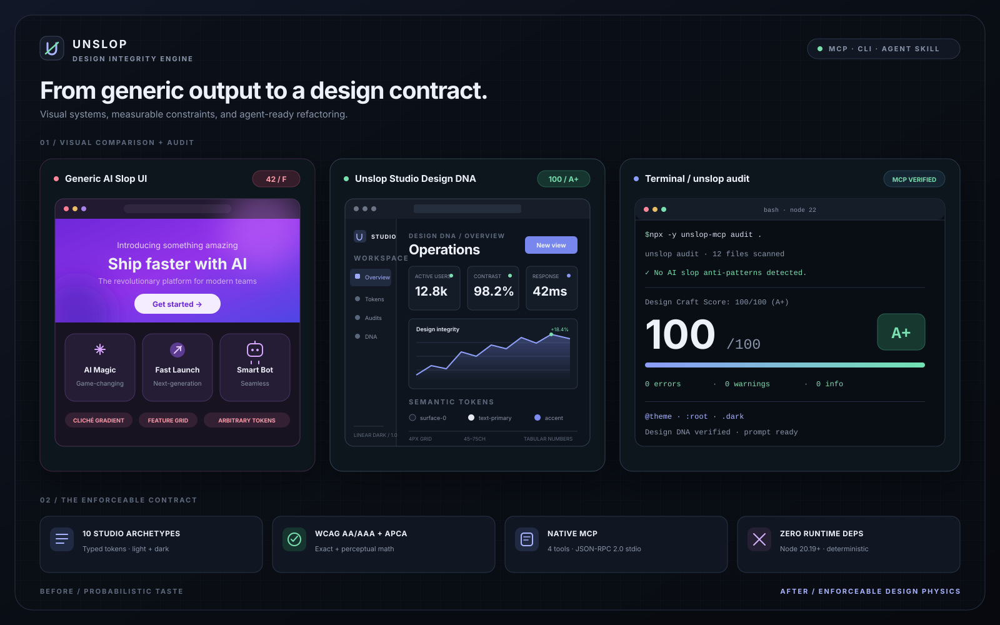
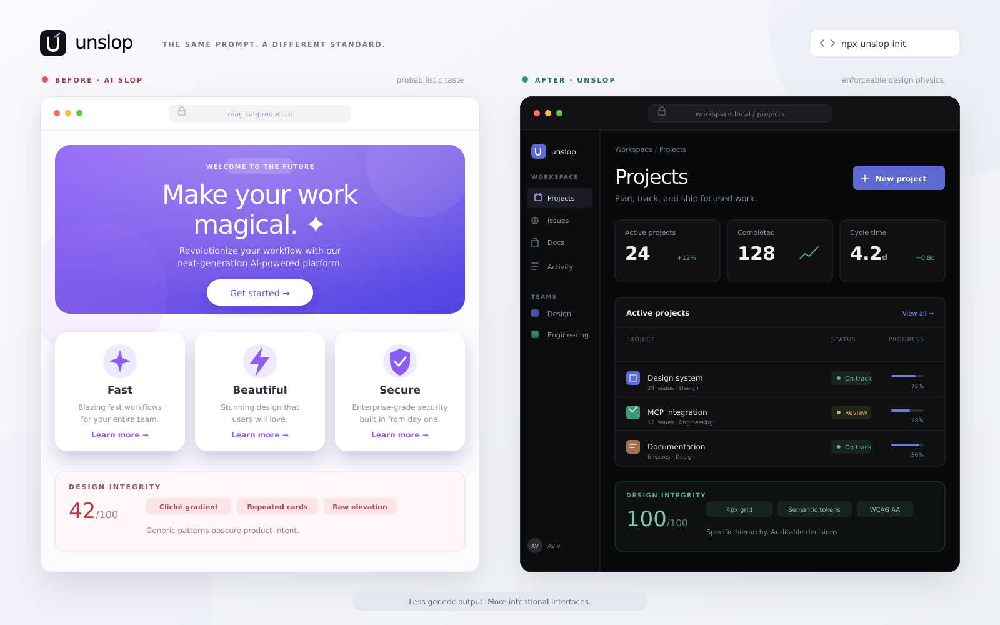

# unslop v2.1.0

**Your agent can write the code. unslop gives it a measurable design engineering protocol.**

[](https://www.npmjs.com/package/unslop-mcp)
[](https://www.npmjs.com/package/unslop-mcp)
[](https://github.com/avivgerz-hue/unslop/actions/workflows/ci.yml)
[](https://nodejs.org/)
[](LICENSE)



`unslop` is a zero-runtime-dependency **UI/UX Design Engineering CLI, native MCP Server, and AI Agent Skill**. It audits 72 rules across seven design craft pillars, installs ten studio-grade archetypes, extracts Design DNA, exports four token formats, and turns every finding into an exact, prioritized transformation blueprint for JSX/TSX, HTML, Vue, Svelte, CSS, and Tailwind codebases.

Works natively with **Claude Code, OpenCode, OpenAI Codex, Cursor, Windsurf, GitHub Copilot, Cline/Roo Code, Zed**, and universal Agent Skills.

## Design Studio & Slop Roaster

Open [`docs/index.html`](docs/index.html) or serve `docs/` as a static site to try the interactive 7-pillar audit, demo, ten-archetype preview, token exports, score badge, and sharing. Paste audits run locally without uploading code. Public GitHub repository audits fetch up to 20 supported files of at most 100 KB each from the default branch via GitHub's unauthenticated API; the result is a labeled sample, not a full repository audit. API rate limits apply. The preview safely adapts simple heading and paragraph copy into an illustrative token-styled component; it never runs or rewrites source code. Clipboard access requires a secure context such as HTTPS or localhost.

For GitHub Pages, configure the repository's Pages source to the `main` branch and `/docs` directory. Regenerate the self-contained page after changing the studio, analyzer, presets, or token exporter with `npm run build:studio`; CI checks that the committed page is current.

Human-readable CLI audits and refactor plans include a copyable badge for the calculated grade and a GitHub star link. Commands that do not calculate a score show a clearly labeled example badge. JSON and MCP stdio are never decorated.



```bash
npx -y unslop-mcp init --preset linear-precision
npx -y unslop-mcp audit .
npx -y unslop-mcp refactor-plan . --report UNSLOP-REPORT.md
```

## Supported Coding Agents (Claude Code, OpenCode, Codex, Cursor, Windsurf, Copilot, Cline, Zed)

Install the universal integrations from the official v2.1.0 GitHub tag in any project:

```bash
npx -y github:avivgerz-hue/unslop#v2.1.0 init --preset linear-precision
```

| Agent | Native files generated by `unslop init` |
| --- | --- |
| **Claude Code** | `.mcp.json`, `CLAUDE.md`, `.claude/skills/unslop/SKILL.md`, `.claude-plugin/plugin.json` |
| **OpenCode** | `opencode.json` with `mcp.unslop-mcp`, plus `AGENTS.md` |
| **OpenAI Codex CLI / Universal Agents** | `AGENTS.md` and `.agents/skills/unslop/SKILL.md` |
| **Cursor** | `.cursor/mcp.json`, `.cursor/rules/unslop.mdc`, and legacy `.cursorrules` |
| **Windsurf** | `.windsurfrules` |
| **VS Code / GitHub Copilot** | `.vscode/mcp.json` and `.github/copilot-instructions.md` |
| **Cline / Roo Code** | `.clinerules` |
| **Zed** | `.zed/settings.json` under `context_servers` |

Restart or reload the agent after installation so it discovers the new MCP server and Skill. Existing instructions outside Unslop's managed block, unrelated MCP servers, settings, inputs, and custom fields are preserved. Running `init` again is byte-for-byte idempotent.

This repository itself includes root `AGENTS.md`, `CLAUDE.md`, `opencode.json`, `.claude-plugin/plugin.json`, and both Claude/Codex Skill paths for immediate auto-discovery.

## GitHub Actions CI

Use the major-version action tag for a non-blocking score report:

```yaml
steps:
  - uses: actions/checkout@v4
  - uses: avivgerz-hue/unslop@v2
    with:
      target: .
```

Enforce the complete design-quality gate and generate an executable blueprint:

```yaml
steps:
  - uses: actions/checkout@v4
  - uses: avivgerz-hue/unslop@v2
    with:
      target: src
      strict: true
      preset: linear-precision
      report: UNSLOP-REPORT.md
```

| Input | Default | Behavior |
| --- | --- | --- |
| `target` | `.` | Component file or directory to analyze |
| `strict` | `false` | `true` fails on findings or a Design Craft Score below 95; `false` reports without failing |
| `preset` | empty | Archetype for exact before/after blueprint translations |
| `report` | empty | Blueprint destination; setting `preset` or `report` generates `UNSLOP-REPORT.md` by default |

The action uses the published `unslop-mcp@2.1.0` package. Its optional blueprint is generated before the strict audit gate, so the report remains available for artifact upload when the audit fails.

The result is not a generic prompt. It is a versioned token contract, a **Design Craft Score from 0–100**, a seven-pillar scorecard, exact before/after translations, and file-level steps your agent can execute in one coherent pass.

## v2 at a glance

| Capability | v2 contract |
| --- | --- |
| Design Craft Engine | **72 rules · 7 pillars · A+–F grades** |
| Color analysis | Exact **WCAG 2.1 AA/AAA** plus **APCA-inspired perceptual checks** |
| Studio archetypes | **10** complete production design systems; five v1 IDs remain compatible |
| Token formats | Tailwind v4 `@theme`, Tailwind v3 config, CSS custom properties, W3C Design Tokens JSON |
| Transformation | `refactor-plan` CLI and `unslop_refactor_plan` MCP tool generate `UNSLOP-REPORT.md` |
| Agent protocol | Five-step principal UI/UX design engineer [`SKILL.md`](SKILL.md) |
| Runtime | Node.js 20.19+, JSON-RPC 2.0 stdio, **zero runtime dependencies** |

## The 7-Pillar Design Craft Engine

Run a deterministic baseline before letting an agent rewrite the interface:

```bash
npx -y unslop-mcp audit . --json
```

```text
Design Craft Score: 78/100 (C)
7-Pillar Scorecard:
  Color & Contrast: 82/100 (B) · 3 findings
  Typography & Hierarchy: 76/100 (C) · 4 findings
  Layout & Spatial Rhythm: 70/100 (C) · 5 findings
  Surface & Elevation: 88/100 (B) · 2 findings
  Copy & Microcopy: 82/100 (B) · 3 findings
  Interaction & Motion: 58/100 (F) · 7 findings
  Theme & Token Architecture: 90/100 (A) · 2 findings
```

| Pillar | Canonical rules | What the engine detects |
| --- | --- | --- |
| **1 · Color, Atmospheric Polarity & Contrast Math** | `SLOP-COLOR-*` | Purple/pink/indigo clone gradients, neon glows, absolute black/white glare, muddy grays, hardcoded component colors, low-opacity text, exact WCAG AA/AAA, APCA-inspired polarity |
| **2 · Typography & Scannable Hierarchy** | `SLOP-TYPE-*` | Fixed display scales, monotonous heading weights, paragraphs beyond readable measure, missing `tabular-nums`, cramped body leading, loose display leading, untracked uppercase labels |
| **3 · Layout, Spatial Rhythm & Grid Craft** | `SLOP-LAYOUT-*` | Centered three-card clones, nested cards, off-grid arbitrary values, excessive container rounding, arbitrary grids, missing content measures, conflicting spacing and radii |
| **4 · Visual Restraint & Surface Elevation** | `SLOP-SURFACE-*` | Glassmorphism overuse, heavy dark-mode shadows, decorative blur blobs, icon badge clutter, unanchored raw elevation, ad-hoc shadow stacks |
| **5 · Copywriting & Microcopy Anti-Slop** | `SLOP-COPY-*` | 100+ cliché variants, including “Unleash the power,” “Revolutionize,” “Supercharge your workflow,” “Seamless integration,” “Next-generation,” hype, filler, superlatives, and emoji spam |
| **6 · Interactive Ergonomics, Motion & States** | `SLOP-UX-*` | Clickable divs, missing labels and keyboard rings, incomplete hover/active/disabled states, small targets, positive `tabindex`, `transition-all`, missing reduced-motion behavior |
| **7 · Theme Parity & Token Architecture** | `SLOP-TOKEN-*` | Broken Canvas → Surface-1 → Surface-2 → Interactive → Border order, asymmetric dark overrides, missing dark companions, off-grid or mistyped tokens |

Legacy `slop/*` IDs remain in output for compatibility. Canonical `SLOP-*` findings drive the v2 seven-pillar score, with location-level deduplication so compatibility output does not double-penalize a finding.

### Scores with an action attached

Every audit includes exact `file:line:column` diagnostics and refactoring instructions. The overall score is the rounded mean of seven independently capped pillar scores; **95–100 is A+**. Use `--fail-under` in CI or agent loops:

```bash
npx -y unslop-mcp audit . --fail-under 95
npx -y unslop-mcp audit . --prompt
npx -y unslop-mcp audit src --json --no-fail
```

Static analysis never replaces rendered verification. Keyboard operation, responsive behavior, actual contrast, content overflow, and reduced motion still need explicit inspection.

## Design Transformation Blueprint

`unslop_refactor_plan` turns the audit into an executable **Design Transformation Blueprint** instead of a list of vague taste suggestions:

```bash
npx -y unslop-mcp refactor-plan . --preset linear-precision --report UNSLOP-REPORT.md
```

The report contains:

1. **Design Craft Score and 7-Pillar Scorecard.**
2. **Before → After Class & Token Translation Table** mapping detected classes, hex/RGB literals, off-grid values, and cliché copy to exact replacements from the selected archetype.
3. **Prioritized P0/P1/P2 file:line steps** covering the entire interface transformation.
4. **Acceptance criteria** for reaching 95–100 without suppressing rules or losing accessible states.

Example translations:

| Before | After |
| --- | --- |
| `from-purple-500 via-pink-500 to-indigo-500` | `bg-[var(--surface-1)] text-[var(--text-primary)]` |
| `shadow-xl` | `border border-[var(--border-subtle)] shadow-[var(--shadow-md)]` |
| `p-[13px]` | `p-[var(--spacing-12)]` |
| `rounded-3xl` | `rounded-[var(--radius-lg)]` |
| `transition-all` | `transition-colors motion-reduce:transition-none` |
| `#777777` | `var(--text-primary)` |
| “Unleash the power” | A concrete product capability and verifiable user outcome |

Use `--json` for the complete machine-readable blueprint:

```bash
npx -y unslop-mcp refactor-plan src --preset swiss-editorial --report reports/DESIGN.md --json
```

## 10 Studio-Grade Design Archetypes

Inspect and install a complete token and agent-rule contract:

```bash
npx -y unslop-mcp presets
npx -y unslop-mcp presets anthropic-warm-editorial
npx -y unslop-mcp init --preset anthropic-warm-editorial
```

| Archetype | Visual and engineering thesis |
| --- | --- |
| `swiss-editorial` | High-contrast editorial grid, warm paper, serif/grotesk pairing, crisp hairline rules |
| `linear-precision` | Obsidian craft, luminance borders, compact tracking, subtle layers, tabular precision |
| `stripe-atmospheric` | Refined slate atmosphere, crisp white surfaces, cobalt trust, layered micro-shadows |
| `vercel-monochrome` | Architectural monochrome, geometric rhythm, zero decorative bloat, semantic status color |
| `teenage-engineering` | Tactile industrial UI, monospace labels, international orange, physical grid borders |
| `anthropic-warm-editorial` | Parchment and stone, literary serif headings, calm clay accents, generous reading measure |
| `bloomberg-terminal-dense` | Ultra-high data density, strict numeric alignment, compact workflows, semantic tickers |
| `raycast-command` | Frosted graphite command palette, keyboard-first selection, crisp shortcut badges |
| `fintech-institutional` | Deep forest-navy authority, legible financial hierarchy, restrained brass and emerald |
| `neo-brutalist-craft` | Intentional ink borders, offset hard shadows, bold geometric contrast, disciplined rhythm |

Each archetype includes full surface hierarchy, explicit light/dark companions, typography scale and weights, spacing rhythm, radii, shadow/border elevation, layout contract, motion curve and spring values, plus ten archetype-specific design laws.

The v1 IDs `linear-dark`, `swiss-grid`, `stripe-minimal`, `apple-glass`, and `neo-brutalist` remain loadable for existing installations; the canonical v2 gallery contains the ten systems above.

## Four token formats — presets or extracted DNA

Use the same deterministic exporter for a built-in archetype or extracted Design DNA.

### Tailwind v4 `@theme`

```bash
npx -y unslop-mcp export-tokens --preset linear-precision --format tailwind-v4 --out tokens.css
```

Produces `@theme`, `:root`, and `.dark` contracts with semantic colors, fonts, fluid type, tracking, weights, radii, shadows, spacing, motion, and layout values.

### Tailwind v3 configuration fragment

```bash
npx -y unslop-mcp export-tokens --preset linear-precision --format tailwind-v3 --out tailwind.config.js
```

Emits a mergeable `theme.extend` fragment with semantic utilities.

### Pure CSS custom properties

```bash
npx -y unslop-mcp export-tokens --preset linear-precision --format css --out tokens.css
```

Emits standalone `:root` and `.dark` variables without requiring Tailwind.

### W3C Design Tokens JSON

```bash
npx -y unslop-mcp export-tokens --preset linear-precision --format w3c-json --out tokens.json
```

Emits typed `$type` / `$value` groups for light and dark colors, typography, dimensions, radii, spacing, shadows, motion, and layout. A `.json` output path infers this format automatically.

### Extract Design DNA from CSS or a URL

```bash
npx -y unslop-mcp extract https://example.com --name reference --json -o design-dna.json
npx -y unslop-mcp export-tokens --source https://example.com --name reference --format w3c-json --out tokens.json
```

The extractor reads local CSS or live HTML, inline styles, linked stylesheets, and `@import` graphs with explicit byte, request, and stylesheet budgets. Extraction warnings remain visible rather than silently inventing missing tokens.

## Native MCP Server

Start the zero-dependency JSON-RPC 2.0 stdio server:

```bash
npx -y unslop-mcp --mcp
```

`init` merge-safely creates or updates `.mcp.json` without replacing unrelated servers, top-level settings, or custom fields on the unslop entry:

```json
{
  "mcpServers": {
    "unslop": {
      "command": "npx",
      "args": ["-y", "unslop-mcp", "--mcp"]
    }
  }
}
```

Claude Code can register it explicitly:

```bash
claude mcp add --scope project unslop -- npx -y unslop-mcp --mcp
```

| MCP tool | Purpose |
| --- | --- |
| `unslop_audit` | 72-rule diagnostic, Design Craft Score, seven-pillar scorecard, exact findings |
| `unslop_extract_dna` | CSS/URL extraction and a complete compiled Design DNA preset |
| `unslop_apply_preset` | Install any canonical archetype and merge project agent rules/MCP configuration |
| `unslop_refactor_plan` | Generate `UNSLOP-REPORT.md` with exact translations and prioritized transformation steps |

Positional `mcp` remains a backward-compatible alias for `--mcp`.

## Principal UI/UX Design Engineer Skill

The rewritten [`SKILL.md`](SKILL.md) is a five-step execution protocol for Claude Code, Cursor, Windsurf, and other coding agents:

1. **Anti-Slop Diagnostic:** baseline all seven pillars with `unslop_audit`.
2. **Aesthetic Direction & Token Foundation:** choose one archetype or extract Design DNA; install tokens before editing components.
3. **Structural & Layout Transformation:** use `unslop_refactor_plan` to replace clone layouts, enforce rhythm, and apply exact translations.
4. **Surface, Typography & Copy Polish:** implement semantic colors, WCAG contrast, fluid type, tabular numbers, and concrete product copy.
5. **Interactive Ergonomics & Verification:** complete focus and state behavior, then re-audit to **95–100/100 (A+)** and inspect the rendered result.

`init` installs the selected contract into all native paths in the agent matrix above, including Claude/Codex Skills, Cursor and Copilot rules, and merge-safe MCP configuration for Claude Code, OpenCode, Cursor, VS Code, and Zed. Existing content outside managed blocks and unrelated JSON fields are preserved; repeated installs are byte-for-byte idempotent.

## Alternative: zero-build GitHub execution

The npm package is the primary installation path. To execute the committed distribution directly from GitHub:

```bash
npx -y github:avivgerz-hue/unslop --version
npx -y github:avivgerz-hue/unslop init --preset linear-precision
npx -y github:avivgerz-hue/unslop --mcp
```

The repository includes `dist/`. During a GitHub install, `prepare` uses TypeScript when available and otherwise validates and reuses the committed runtime and all fifteen canonical-plus-legacy preset JSON files. No production dependency or local compilation step is required.

## Docker MCP

```bash
docker build --tag unslop:mcp .
docker run --rm -i unslop:mcp
```

The image entrypoint is `node dist/bin/unslop.js mcp`. CI builds the image and verifies `initialize`, silent handling of `notifications/initialized`, and all four tools in `tools/list` over stdio with networking disabled.

## Registry and citation metadata

- [`server.json`](server.json) follows the official MCP Registry schema and declares `unslop-mcp` 2.1.0 with the `npx -y … --mcp` startup contract and four tool summaries.
- [`glama.json`](glama.json) mirrors the exact MCP tool schemas and canonical archetype enum.
- [`smithery.yaml`](smithery.yaml) starts the native stdio server without additional configuration.
- [`CITATION.cff`](CITATION.cff) provides software citation metadata for VibeFoundry.

The npm package is published as [`unslop-mcp`](https://www.npmjs.com/package/unslop-mcp). These files support registry indexing but do not claim that a registry listing has occurred.

## Development and verification

```bash
npm ci
npm run typecheck
npm test
npm run build
```

CI verifies Node.js 20 and 22, a production install without TypeScript, reproducible committed `dist/`, real CLI/MCP stdio negotiation, and the Docker MCP handshake. The v2 suite covers all seven pillars, all ten archetypes, every token format, extracted DNA, refactor blueprints, and manifest-driven 2.1.0 version output.

## License

MIT · VibeFoundry
